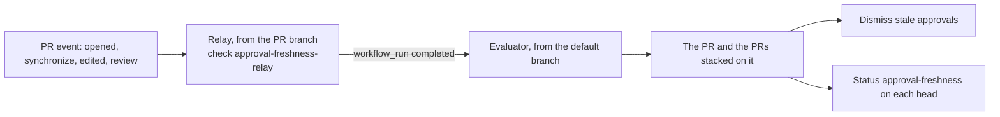
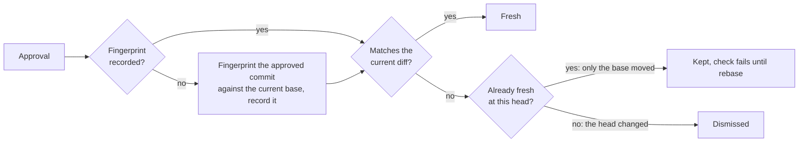

# Approval freshness

Pull request approvals are dismissed only when the pull request diff changed
since they were given. This replaces the ruleset setting "Dismiss stale pull
request approvals when new commits are pushed", which also dismisses whenever
the merge base moves, and so on every rebase of a stack of pull requests.

Files:

- `.github/workflows/approval-freshness-relay.yml`: the relay, a no-op run on
  pull request events.
- `.github/workflows/approval-freshness.yml`: the evaluator, started by the
  relay's completion.
- `.github/scripts/approval-freshness.js`: the evaluation itself.

## How it works

How a pull request event reaches the evaluation:

The relay runs on `pull_request` (opened, reopened, synchronize, edited) and
`pull_request_review` (submitted, dismissed). The evaluator runs on
`workflow_run` of the relay, so always from the default branch with a write
token, whatever the pull request's base and origin: `pull_request_target` would
run the lower pull request's branch in a stack, and `pull_request_review` gives
fork pull requests a read-only token. Pull request commits are fetched and
diffed, never executed.

What happens to each approval:

- **Fingerprint.** `git patch-id --verbatim` of the diff between the head and
  its merge base with the live tip of the base branch (the API's `base.sha` is a
  snapshot). Line numbers are ignored; whitespace, file modes and binary content
  are not. Changes within 3 lines of a hunk alter its context, so they count.
- **Record.** An approval's fingerprint is recorded when the approval is first
  seen, in `approval-freshness-record` check runs on the approved commit:
  recomputing it later would diff against a lower branch that may have been
  amended or squash-merged since. A commit's record is the union of all its
  record check runs, the earliest fingerprint winning, so concurrent runs cannot
  lose one. A run is written only when the record grows, so a commit nobody
  approved carries none.
- **Dismissed** when the head changed since the approval was last fresh, or
  when the approved commit no longer exists or shares no history with the base.
- **Kept, with the check failing,** when only the base moved: a lower pull
  request amended without restacking, or a retarget before the rebase. A
  dismissal is irreversible, and the head still holds what was approved.
  Rebasing re-evaluates the approval: fresh if the diff matches again, dismissed
  otherwise.
- **Moving head.** The pull request is read again after its reviews: if its
  head or base moved meanwhile, the evaluation starts over on the pull request
  as it is now, at most 3 times, so an approval of a newer head is never
  compared with an older one and dismissed.
- **Stacks.** Moving a base branch sends no event to the pull requests based on
  it, so evaluating a pull request also evaluates the pull requests stacked on
  it.

The `approval-freshness` commit status on the head passes when every remaining
approval matches the current diff. It fails when the base moved, when a stale
approval could not be dismissed, or when the evaluation failed; a transient
fetch error blocks rather than dismisses. Its details link to the evaluator run,
whose log lists each approval.

It is a commit status rather than a check run: a check run created through the
API joins an existing GitHub Actions check suite of the commit, apparently the
oldest, with no way to choose. A pull request keeps only the latest run of each
workflow and hides the whole suite of an earlier one, so when that workflow
runs again on the same commit, as when one push sends two events, the check run
is hidden with it. A status belongs to no suite. The record cannot move to the
status, whose description holds about 140 characters; the record check runs
stay readable through the API whatever their suite.

## When the check fails

| Status description | Action |
|---|---|
| The base moved: rebase to re-evaluate N approval(s) | Rebase or restack the pull request. |
| N stale approval(s) could not be dismissed | Check that GitHub Actions may dismiss reviews, then re-run the evaluator. |
| Approvals could not be evaluated | Read the evaluator's log, then re-run it. A pull request that kept moving during the evaluation is evaluated again by its next event. |

A head without any `approval-freshness` status means the relay did not run: the
pull request has a merge conflict, the commit was pushed with `GITHUB_TOKEN`, or
a fork run awaits approval. The next pull request event, or a manual run of the
"Approval freshness" workflow with the pull request number, evaluates it.

## Setup

1. Run the "Approval freshness" workflow manually with no input, so open pull
   requests get their `approval-freshness` status. They also need a push or a
   review to get `approval-freshness-relay`.
2. In the ruleset, disable "Dismiss stale pull request approvals when new
   commits are pushed". The number of required approvals stays in the ruleset.
3. Require the `approval-freshness` (a commit status) and
   `approval-freshness-relay` status checks, with GitHub Actions as their
   source.
4. Review "Require approval of the most recent reviewable push", which may
   still require re-approval after a rebase.
5. If review dismissal is restricted, allow GitHub Actions; otherwise the check
   fails closed.
6. Keep forced pushes to the default branch blocked: see the base moves below.

## Limits

- **Not a security boundary.** Any pull request workflow with a write token
  can post a passing `approval-freshness` status from the same GitHub Actions
  source. This guards against mistakes, not against an author with write
  access. Closing that needs a dedicated GitHub App as the required check's
  source, with its key in an environment restricted to the default branch.
- **Base moves without an event are not followed.** A branch that is no pull
  request head being rewritten, or a merge bringing into the base commits the
  pull request already contains, waits for the pull request's next event.
  Neither lets a stale approval land content in the default branch, which
  rejects forced pushes and only takes content through a pull request evaluated
  against its own diff.
- **Display.** A pull request whose base moved shows its approvals until it is
  rebased, its merge blocked meanwhile. A pull request whose relay did not run
  shows its stale approvals until its next evaluation.
- **Push back to an old head.** A commit once evaluated as head keeps its last
  status until the relay-triggered run re-evaluates it, about a minute later.
- **Late fingerprint.** An approval first fingerprinted after the base moved (a
  relay run awaiting approval, a failed run, the rollout) is fresh if its
  commit is still the head, whatever the base was when it was given.
- **Interactions.** An unchanged diff on top of a changed lower pull request
  keeps its approval; interactions between them are left to CI.
- **Non-head records.** An approval first seen on a non-head commit records its
  fingerprint on that commit with a failing status, so a forced push back to
  it stays blocked until evaluated.
- **Cost.** Evaluating a pull request takes 4 REST API calls, plus 1 per
  approved commit other than the head, plus a status read per such commit
  whose record grows, plus the writes and dismissals that something changed,
  against the `GITHUB_TOKEN` limit of 1,000 per hour. A head that moved during
  the evaluation repeats it.
